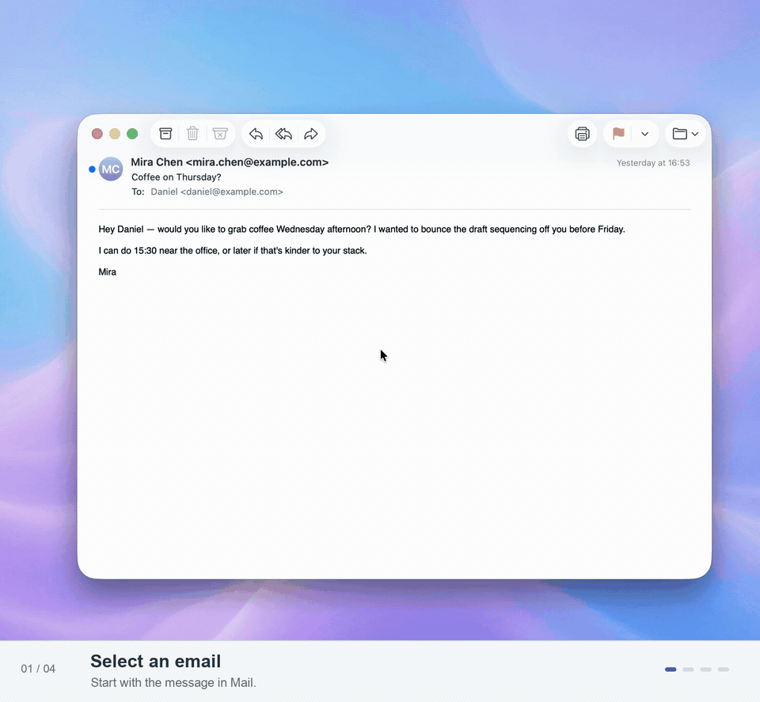
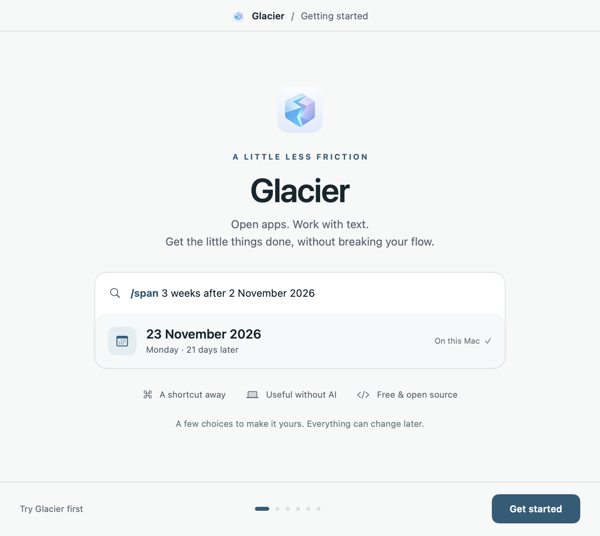

<p align="center">
  
</p>

<h1 align="center">Glacier</h1>
<p align="center"><strong>Your Mac toolkit. One shortcut away.</strong><br>Quietly capable.</p>
<p align="center">Native macOS · Useful without AI · Bring your own API keys · GPL-3.0-only</p>

Glacier brings app launching, file search, writing, visual thinking and everyday utilities into one keyboard-first Mac app. Open it, type a command or bring in selected text, and take the result back to what you were doing.

**Early preview.** This checkout builds a working local app. A signed, notarized public download is still being prepared. Current packaged target: **Apple Silicon, macOS 14.4 or later**.

[Try it locally](#try-it-locally) · [Things to try](#things-to-try) · [Setup and privacy](#make-glacier-yours) · [Contribute](CONTRIBUTING.md)

## From an email to the right words

Bring a message into the command pad, ask for a reply, then use Express to explore another way to say it.



[Watch the 31-second MP4](docs/media/mail-express.mp4) for playback controls and sharper text. This real recording predates the Glacier rename, so it still says Omni in places. Captions and pacing come from the website version; the personal email address is masked. Drafting and Express require a configured model provider.

## A small tool for the task in front of you

| When you want to… | Reach for… |
| --- | --- |
| Open an app or find a file | Launch's keyed app palette, or the launcher and local search over folders you choose |
| Draft a reply, translate a passage or find better wording | Email, Message, Translate and Express |
| Turn an idea into something you can see | Map's seven diagram forms and Concept Lens; copy image and text together |
| Work out dimensions, dates or a quick calculation | Ratio, Span and Calculator, on your Mac |
| Make a QR code or find a symbol | QR, Characters and Emoji, without an AI key |
| Keep useful text within reach | Optional clipboard history, Collect and stash |

Local tools do not need an account or an AI connection. Model-powered tools use **your chosen provider and model**: Cerebras, OpenRouter, OpenAI, Anthropic or Ollama. Provider charges are separate; ChatGPT and Claude subscriptions are not API access. Weather and pronunciation can contact their own services—“without AI” does not always mean offline.

## Try it locally

You need **macOS 14.4+, a Swift 6 toolchain and [uv](https://docs.astral.sh/uv/getting-started/installation/)**. Run these commands from the repository root:

```sh
# Build a local development app, including its pronunciation helper.
uv run --no-project Scripts/package_glacier.py --debug

# Launch the app you just built.
open dist/Glacier.app
```

The first helper build downloads a pinned Python runtime and locked dependencies. They are bundled into the app; end users do not need to install Python. This package is ad hoc signed for development, not notarized for public distribution. The packaging command does not install the app into Applications or enable login startup.

Want to inspect the UI without enabling global shortcuts or clipboard collection? Build and run the isolated preview instead:

```sh
swift build --product glacier --disable-index-store -j 4
glacier_preview_root="$(mktemp -d)/Glacier"
.build/debug/glacier --preview --support-root "$glacier_preview_root"
```

The source-only preview does not include the packaged pronunciation runtime. For optimized builds, archives and the remaining public-download checks, see [release preparation](docs/glacier-release-preparation_88189953575222a9.md).

## Things to try

Type `/` to browse commands. Start with local tools, then add a provider when you want the writing and thinking tools.

| In the command pad | What happens | Connection |
| --- | --- | --- |
| `/calc 18 * 24` | Calculate a result | Local |
| `/span 5 months after 19 october 2026` | Return **19 Mar 2027** | Local |
| `/ratio` | Open the proportions and dimensions tool | Local |
| `/qr https://example.com` | Make a QR code to copy or export | Local |
| `/char U+2191` | Browse characters and copy a symbol | Local |
| `/map compare walking, cycling and taking the train` | Generate a visual comparison | Your model provider |
| `/express Could we move our meeting to Thursday?` | Explore alternative wording | Your model provider |

For an email reply, bring in the message first, then add your direction after `/email`, such as “accept, but suggest Thursday at 14:00.” Glacier separates the source message from your instruction. It drafts and reviews the result in two model calls before showing it; both count toward provider usage.

## Make Glacier yours

<p align="center"></p>

The first-run setup lets you choose an opening shortcut, selected-text access, an AI provider, search folders, clipboard history and login startup. **Try Glacier first** takes you to local examples you can try without completing setup. You can return through **Settings → General → Getting started…**.

- **Permissions are optional.** Selected-text access uses macOS Accessibility; ordinary local tools remain available without it.
- **Collection is opt-in.** Clipboard history starts off, and you choose which folders to search. Search access does not authorize uploading file contents.
- **Saving a key stays local.** Provider credentials use Keychain or an explicitly chosen external reference. **Test connection** is a separate network request.
- **AI runs when you choose.** Automatic requests start off and can be enabled per tool. Content submitted to a cloud provider leaves your Mac; an Ollama profile can use a local model.
- **Shortcuts are yours.** Individual global tool bindings start off. Hyper is optional and requires an external key remapper.
- **Launch is a keyed app palette.** Add up to eight apps by bundle ID in Glacier's manifest, then set its shortcut in **Settings → Shortcuts**. The suggested Hyper layout assigns Hyper+A.

[Using Glacier](docs/using-glacier_d1e043654b567813.md) covers provider setup, Express controls, settings and uninstalling. [Security](SECURITY.md) describes the boundaries and reporting status.

## Built to be understood and extended

Glacier uses **Swift 6 and AppKit**, with SQLite-backed run storage and a bundled pronunciation helper. `GlacierRuntime` composes the app; configuration, provider connections, search and platform effects have separate modules. Some shared source targets retain the `Omni` name from the project's origins. Glacier runs independently and does not need an Omni installation.

To run the synthetic test suite:

```sh
uv run --offline --no-project python Scripts/run_tests.py -- -j 4
```

Tests use temporary state, fake transports and synthetic platform effects. They must not use personal API keys or operate your desktop. The existing [CI workflow](.github/workflows/synthetic.yml) runs Swift and Python checks; its presence is not a claim of a completed public CI run.

Want to add a tool? Start with the runnable [minimal module example](Examples/MinimalModule/README.md):

```sh
swift run --disable-index-store glacier-example
```

It registers a `/trim` tool through the same module interface used by the app. Modules are trusted, compiled code—not a sandbox for downloaded plugins.

Read the [architecture](docs/glacier-architecture_b2669b52851e2771.md) and [contribution guide](CONTRIBUTING.md) for the code map, validation commands and contribution expectations.

## License

Glacier is free software under **[GNU GPL v3 only](LICENSE)** (`GPL-3.0-only`). You can use, inspect, modify and redistribute it under those terms. Dependencies and data retain their own licenses; see [third-party notices](THIRD_PARTY_NOTICES.md) and [demo-media provenance](docs/media/README.md).
